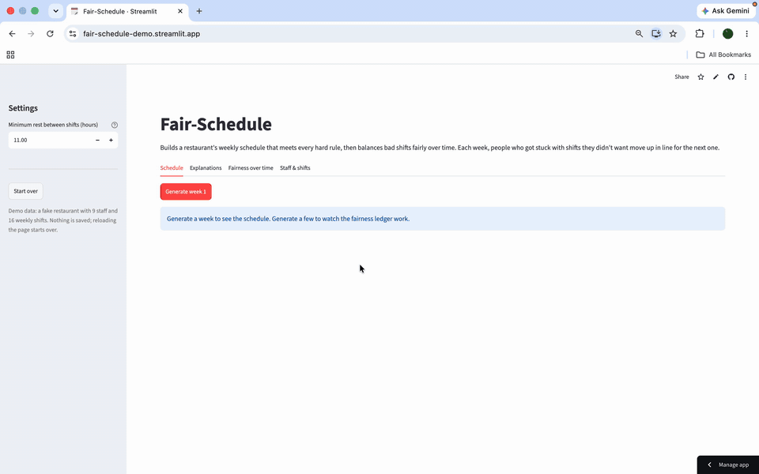
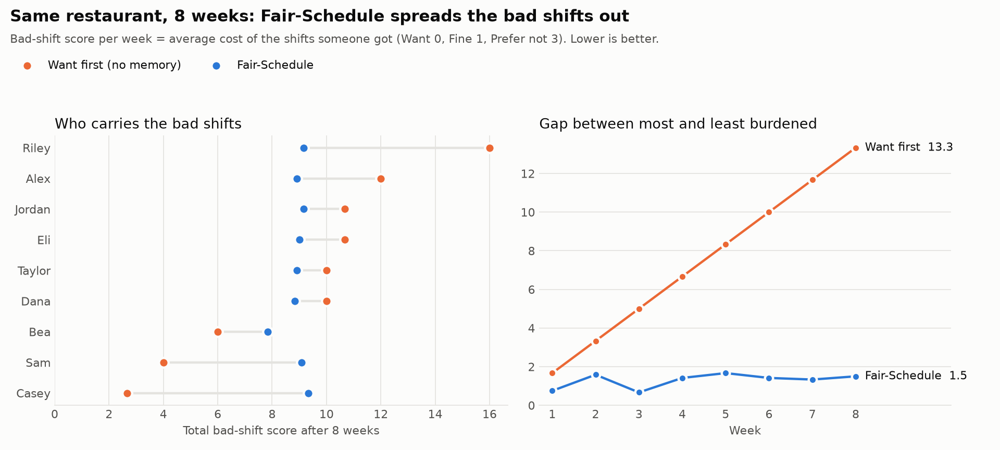
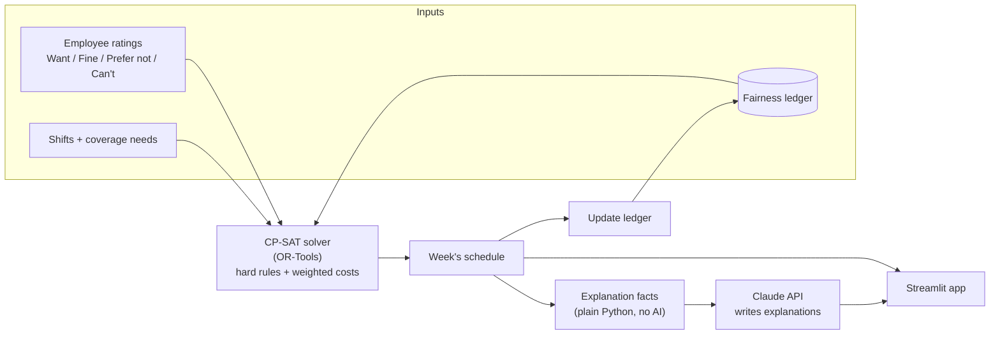

# Fair-Schedule

An AI-assisted restaurant scheduler that keeps track of who keeps getting the bad shifts and evens them out week after week.

**[Try the live demo →](https://fair-schedule-demo.streamlit.app/)** (fake restaurant, nothing is saved)



## The problem

I'm a bartender. In most restaurants a manager builds the schedule by hand, and the same few people end up closing Friday and opening Sunday week after week. It's rarely on purpose: there's no record of who got stuck last time, so the manager can't correct for it.

Fair-Schedule builds a schedule that always meets the restaurant's coverage needs, and it remembers. Each week, anyone who got shifts they didn't want moves up in line for the next one.

## What it does

1. Each employee rates every weekly shift as **Want / Fine / Prefer not / Can't** and sets their min and max shifts per week.
2. The manager clicks **Generate**. A constraint solver builds the week:
   - **Hard rules (always hold):** every shift fully staffed, nobody works a shift they marked Can't, no double-booking, min/max shifts per week, no "clopens" (closing one night and opening the next morning with less rest than the manager allows).
   - **Soft goal:** give people the shifts they want, with priority going to whoever has been unluckiest lately.
3. Claude writes each employee a plain-English explanation of their week: why they got a shift they didn't want, and that they'll get priority next week.
4. The fairness ledger updates, and the next week's schedule takes it into account.

## Does it work? An 8-week simulation

Same restaurant, same preferences every week, two schedulers:

- **Want first:** the same solver with no memory. Each week it gives out as many Want shifts as it can. This is the best a manager can do looking at one week at a time.
- **Fair-Schedule:** the same solver plus the fairness ledger.



After 8 weeks, the gap between the most and least burdened employee is **13.3** with Want first and **1.5** with Fair-Schedule. Want first builds the same week 8 times, so Riley takes the worst shifts every single week. Fair-Schedule spreads them across the team. The trade-off is a little more total "bad-shift points" for the team as a whole: a few people give up some shifts they wanted so nobody gets stuck.

Reproduce it with `python -m spikes.simulation_chart`.

## How it works



| File | What it does |
|---|---|
| `fair_schedule/models.py` | Data model: `Shift`, `Employee`, `Schedule`, `LedgerEntry`, `Rating` |
| `fair_schedule/solver.py` | `solve_week()`: builds the CP-SAT model and solves one week |
| `fair_schedule/fairness.py` | Scores each person's week and updates the ledger |
| `fair_schedule/explanations.py` | Works out the facts behind each person's schedule (no AI) |
| `fair_schedule/ai.py` | Sends those facts to Claude and gets back one explanation per employee |
| `app.py` | Streamlit UI: Schedule, Explanations, Fairness over time, Staff & shifts |
| `spikes/` | Experiments that shaped the design, including the 8-week simulation |

### The fairness score

- Each shift has a cost: **Want 0, Fine 1, Prefer not 3**.
- **Week score** = the average cost of the shifts someone got. It's an average, not a total, so people who work more shifts aren't penalized for it.
- **Ledger** = 0.75 × last week's ledger + this week's score. Old bad luck fades, but slowly.
- **Solver cost** for giving someone a shift = shift cost × (1 + their ledger). The more someone has been stuck lately, the more it "costs" to give them another bad shift, so the solver looks for someone else.
- The solver also minimizes the **worst single week** anyone gets (weight 3). Without it, tied bad shifts all went to one person, and people swung between a terrible week and a perfect one.

## Why I designed it this way

**The solver builds the schedule, not the LLM.** Coverage and availability are rules that must hold every time, and a language model can't guarantee that. OR-Tools' CP-SAT solver either follows every hard rule or reports that no valid schedule exists. Claude does what it's good at: explaining the result in plain English.

**Claude only writes up facts it's given.** My first version sent Claude the schedule and preferences and asked it to explain. It made up plausible-sounding reasons. Now `explanations.py` works out each person's real situation in plain Python first (who else wanted that shift, whether they were already at max shifts, whether it would have been a clopen) and Claude turns those facts into prose. It can't explain with a reason that isn't true.

**A rating form instead of free-text preferences.** Rating every shift is quick, every shift gets a value, and the ratings map straight to solver costs. A form field is also more reliable than an AI reading "I can't do mornings, mostly." Free text is saved for what a form can't express, like manager changes (see below).

**I compared against a strong baseline, not a weak one.** The easy comparison is first-come-first-served, which looks terrible. Instead the baseline is the same solver at its best on any single week. The only difference is memory, so the chart shows what the ledger adds and nothing else.

**Every tuning choice was tested, not guessed.** The decay (0.75) and worst-week weight (3) come from the 8-week simulation runs saved in `spikes/results/`. Two numbers judged each run: **spread** (gap between the most and least burdened person over 8 weeks) and **swing** (how much a person's week score jumps from one week to the next). Weight 3 cut the swing to less than half the baseline (0.47 vs 1.11). Higher weights barely helped and cost more.

**Rules for everyone live in code, rules for one person live in their data.** "No clopens" applies to all staff, so it's a solver constraint (with the rest hours as a manager setting, since laws vary). "Max 4 shifts" is a per-employee field.

## Run it locally

Requires Python 3.11+.

```bash
git clone https://github.com/prettyrad-wav/Fair-Schedule.git
cd Fair-Schedule
python -m venv .venv
source .venv/bin/activate
pip install -r requirements.txt
cp .env.example .env   # then add your ANTHROPIC_API_KEY
streamlit run app.py
```

The schedule, ledger, and chart work without an API key. Only the Explanations tab calls Claude.

## What's next

- **Manager commands:** type "Alex called out Saturday, refill it" and Claude turns it into a structured change for the solver. The re-solve keeps as much of the posted schedule as it can, so people's plans don't change unless they have to.
- **Better infeasibility messages:** when no valid schedule exists, say which rule can't be met.
- **pytest suite** for the solver's hard rules and the ledger math.
- **Real storage** (Postgres) and logins, so a real restaurant could use it.

## Built with

Python · [Google OR-Tools](https://developers.google.com/optimization) (CP-SAT) · [Claude API](https://docs.anthropic.com) · Streamlit · matplotlib
